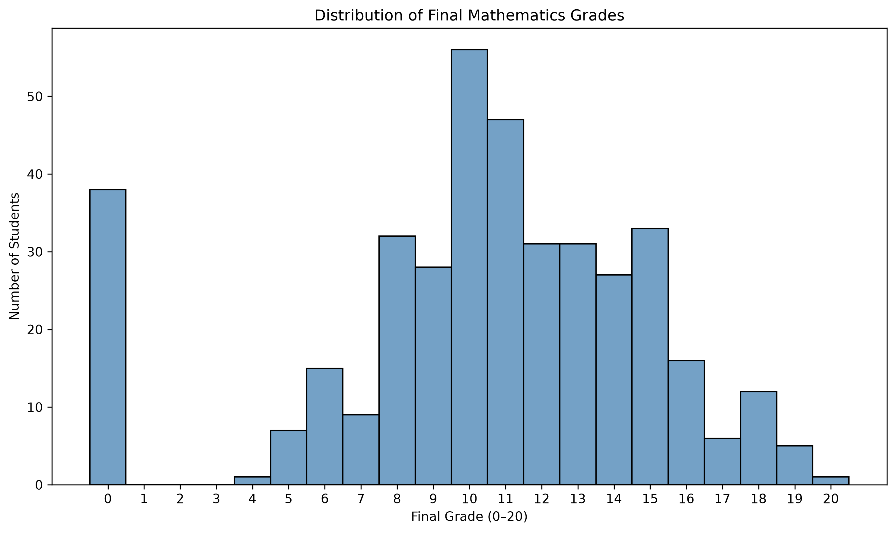
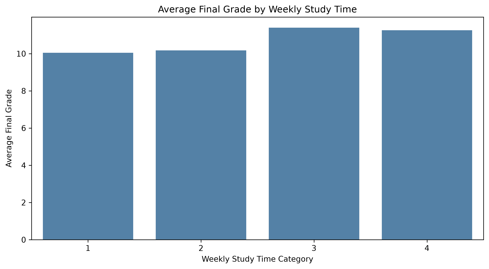
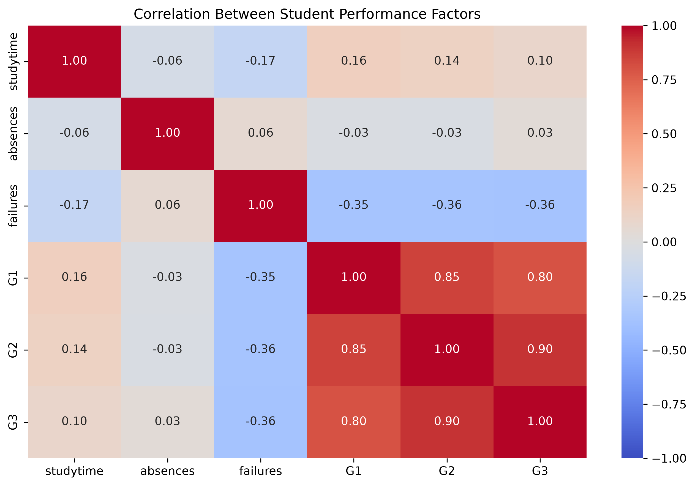
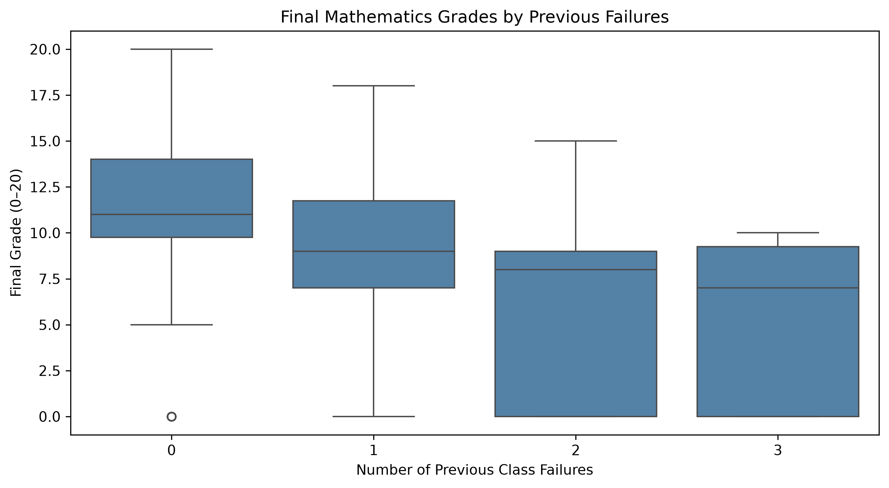
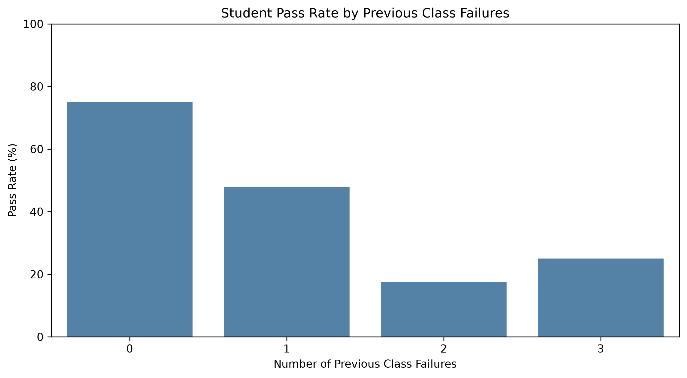

# Student Performance Analysis

### Exploratory Data Analysis Using Python

A Data Science project that explores student academic performance through statistical analysis and data visualization to identify factors associated with final mathematics grades.

## Project Overview

Student Performance Intelligence analyzes real-world educational data to understand how study time, previous academic failures, school absences, and earlier examination grades relate to students' final academic performance.

The project demonstrates an end-to-end Exploratory Data Analysis (EDA) workflow using Python, Pandas, Matplotlib, and Seaborn.

### Objectives

- Explore and understand student performance data.
- Analyze the distribution of final mathematics grades.
- Investigate relationships between study time and academic performance.
- Identify correlations between selected academic factors.
- Examine the relationship between previous failures and final grades.
- Compare student pass rates across different groups.
- Communicate insights through statistical visualizations.

## Dataset

**Dataset:** Student Performance – Mathematics

**Source:** [UCI Machine Learning Repository](https://archive.ics.uci.edu/dataset/320/student+performance)

The dataset contains:

- **395 student records**
- **33 original attributes**
- Academic, demographic, and social characteristics
- Final mathematics grades ranging from 0 to 20

### Important Features

| Feature | Description |
|---|---|
| `studytime` | Weekly study-time category |
| `absences` | Number of school absences |
| `failures` | Number of previous class failures |
| `G1` | First-period mathematics grade |
| `G2` | Second-period mathematics grade |
| `G3` | Final mathematics grade |

## Technologies Used

- **Python** – Data processing and analysis
- **Pandas** – Data manipulation and statistical operations
- **Matplotlib** – Data visualization
- **Seaborn** – Statistical visualization
- **Visual Studio Code** – Development environment

## Project Structure

```text
Student-Performance-Intelligence/
│
├── data/
│   └── student-mat.csv
│
├── visualizations/
│   ├── grade_distribution.png
│   ├── study_time.png
│   ├── correlation_heatmap.png
│   ├── previous_failures.png
│   └── pass_rate.png
│
├── main.py
├── requirements.txt
└── README.md
```

## Exploratory Data Analysis

### 1. Final Grade Distribution

A histogram was created to visualize the distribution of students' final mathematics grades.



**Observation:** Many students scored within the middle range of the grading scale. A noticeable number received a final grade of zero.

### 2. Study Time vs Academic Performance

Students were grouped according to their reported weekly study time, and average final grades were calculated for each category.



**Observation:** Students in higher study-time categories generally achieved slightly higher average grades. However, the relationship was weak and not consistently increasing.

### 3. Correlation Analysis

Pearson correlation coefficients were calculated to investigate linear relationships between selected academic variables.



**Key results:**

| Feature | Correlation with Final Grade (G3) |
|---|---:|
| Second-period grade (G2) | +0.90 |
| First-period grade (G1) | +0.80 |
| Previous failures | −0.36 |
| Study time | +0.10 |
| Absences | +0.03 |

The strongest observed correlations with final grades were previous academic grades, particularly `G2`.

Study time showed a weak positive relationship, while absences had almost no overall linear correlation with final grades.

### 4. Previous Academic Failures

A boxplot was used to compare final mathematics grades among students with different numbers of previous class failures.



**Observation:** Students with more previous failures generally had lower median final grades. However, grade distributions overlapped across groups.

### 5. Student Pass Rate Analysis

Students were classified as passing if their final mathematics grade was at least 10 out of 20.

Pass rates were calculated for groups with different numbers of previous failures.



This analysis allows comparison of academic outcomes across failure groups using percentages rather than only average grades.

## Key Findings

1. **Previous academic performance is strongly associated with final grades.** Both first-period and second-period grades showed strong positive correlations with final mathematics grades.

2. **Previous academic failures are negatively associated with performance.** Students with more previous failures generally achieved lower final grades.

3. **Study time has a weak positive relationship with academic performance.** Higher study-time categories had slightly higher average grades, but the overall correlation was small.

4. **Absences showed almost no overall linear correlation with final grades.** This does not rule out nonlinear relationships or effects involving other variables.

5. **Statistical visualization helps reveal patterns that are not obvious from raw data alone.**

## How to Run the Project

### 1. Clone the repository

```bash
git clone https://github.com/Vignesh-3009/Student-Performance-Analysis.git
```

### 2. Navigate to the project directory

```bash
cd Student-Performance-Intelligence
```

### 3. Install dependencies

```bash
python -m pip install -r requirements.txt
```

### 4. Run the analysis

```bash
python main.py
```

The program will:

- Load the dataset.
- Display descriptive statistics.
- Calculate group averages and correlations.
- Analyze student performance patterns.
- Generate and save five visualizations in the `visualizations` directory.

## Limitations

- The dataset contains records from two Portuguese secondary schools and may not represent students in other regions.
- Correlation does not establish causation.
- Weekly study time is represented by categories rather than exact hours.
- Some previous-failure groups may contain relatively few students.
- The analysis is exploratory and does not include a trained predictive model.
- The findings should not be interpreted as definitive explanations of academic performance.

## Dataset Attribution and License

This project uses the [Student Performance dataset](https://archive.ics.uci.edu/dataset/320/student+performance) from the UCI Machine Learning Repository.

**Original authors:** Paulo Cortez and Alice Silva.

**Reference:**

Cortez, P., & Silva, A. (2008). *Using Data Mining to Predict Secondary School Student Performance.* Proceedings of the 5th Future Business Technology Conference.

**Dataset license:** [Creative Commons Attribution 4.0 International (CC BY 4.0)](https://creativecommons.org/licenses/by/4.0/).

The original `student-mat.csv` file is used without modification. Additional variables for analysis are generated during program execution.

## Conclusion

Student Performance Intelligence demonstrates how Python-based exploratory data analysis can transform educational records into interpretable statistical insights.

The analysis highlights strong relationships between previous academic performance and final mathematics grades, alongside weaker associations with reported study time and absences.

This project showcases practical skills in data exploration, descriptive statistics, feature engineering, correlation analysis, and data visualization.

---

**Project Type:** Data Science | Exploratory Data Analysis | Statistical Visualization
